# Shelfline

**[Watch the 4-minute demo](docs/shelfline-demo.mp4)** · offline till, back office, stock, people, commission, online store, Shopify, marketing, Xero export and reordering, row security (synthetic data). Re-record: `cd demo && npm install && node record.mjs`.

Multi-location retail and POS platform, written as a portfolio project (**all data is synthetic**). One stock ledger and one cash ledger sit under an offline-first iPad till, a back-office admin and a device-bridge plan. Phase 1 (the selling core, M1–M8) is complete and runs on its own. Phase 2 has started: purchasing and supplier finance (M9), transfers and stock counts (M10) and price books and promotions (M11) gift cards and store credit (M12) and schedules and timesheets (M13) and attendance terminals with a Go device bridge (M14, simulator only) are built. The rest of phases 2 and 3 is planned, not built.

| | |
|---|---|
| Planning | [BREAKDOWN.md](BREAKDOWN.md) · [docs/PRD.md](docs/PRD.md) · [docs/TECH-SPEC.md](docs/TECH-SPEC.md) · [docs/MILESTONES.md](docs/MILESTONES.md) · [docs/IA.md](docs/IA.md) · [docs/SCREENS.md](docs/SCREENS.md) |
| Design | [DESIGN.md](DESIGN.md) ("shelf-edge": graphite, volt, dot-leader sheets) · [mockups/index.html](mockups/index.html) |
| Status | **Built through M24** (24 milestones, each with a written status and its limits in [docs/MILESTONES.md](docs/MILESTONES.md)). P1: foundation and auth, catalogue and tax, stock ledger, sync engine, iPad POS, cash and refunds, admin, purchasing, terminals and time, gift cards, pricing, transfers and counts. P2: commission, report portal, notifications, automatic end-of-day reports, devices (receipt printing, scanner, SQLite, card terminal). P3: online store (Next.js), Shopify channel, marketing and loyalty, accounting export to Xero and reorder suggestions. M24: row-level security per organisation, several organisations, single sign-on, a second terminal dialect, backup restore proof, performance budgets, dependency audit. |
| Not done | Anything that needs the outside world: a real iPad/Safari run, receipt printer, cash drawer, card terminal, fingerprint terminals, a real Shopify store, Xero organisation or identity provider are all built against stand-ins and listed as unverified in [docs/HARDWARE-TESTS.md](docs/HARDWARE-TESTS.md). No deployment. |
| Read next | [Case study](docs/CASE-STUDY.md) · [Operating it: tenancy, SSO, backups, speed, dependencies](docs/OPERATIONS.md) |

## What you can see

The demo organisation is **Kestrel Run Co.**: four stores (Fitzroy, South Yarra, Fremantle, Newcastle) and a distribution centre, 904 variants, 300 customers and 90 days of till traffic (about 14,500 sales and 800 refunds, A$2.7m), pushed through the real sync endpoint, plus nine suppliers and 20 purchase orders in every state with deliveries and bills. A few anomalies are planted: short tills, negative stock, a no-sale without a reason, a bill that claims goods that have not arrived, a bill priced above its order.

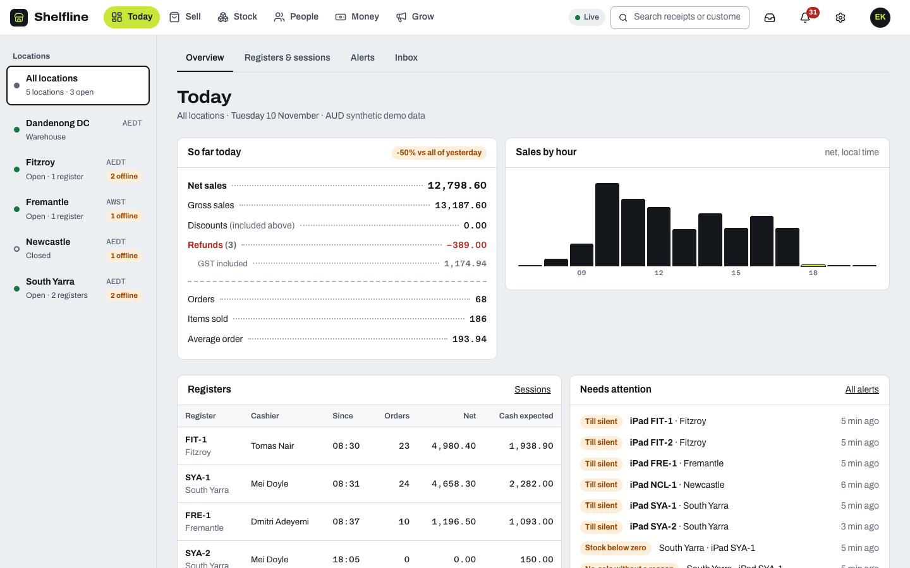

| Registers and sessions | Alerts |
|---|---|
| 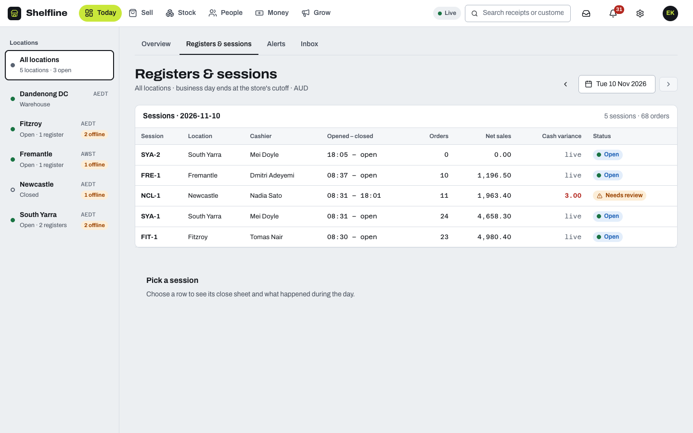 | 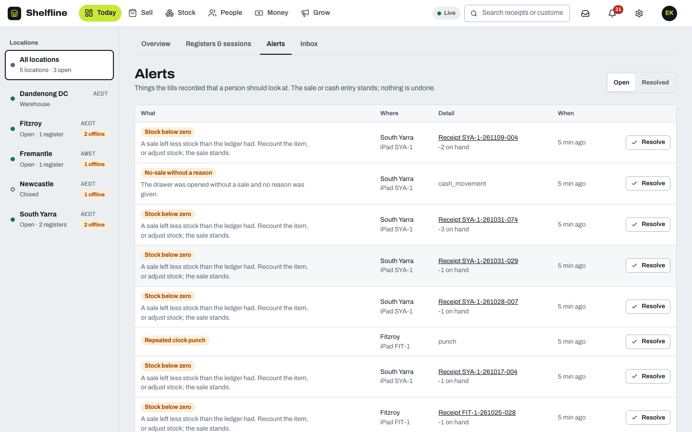 |

| The till (iPad landscape) | Sync screen | Phone |
|---|---|---|
| 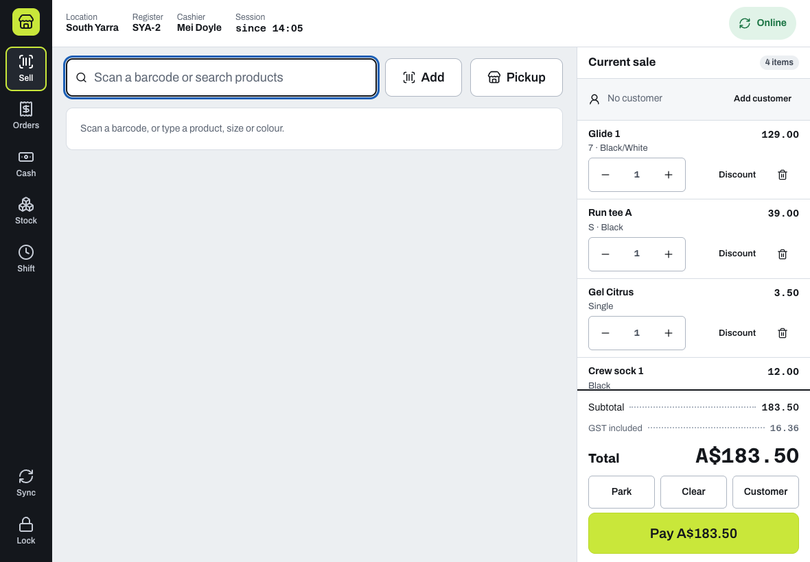 | 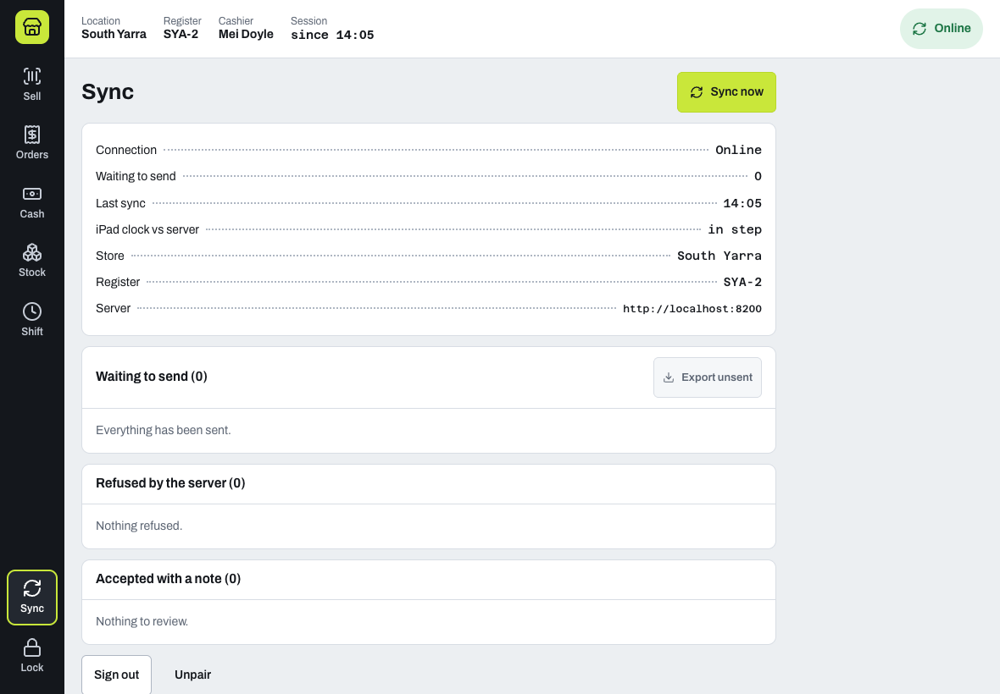 | 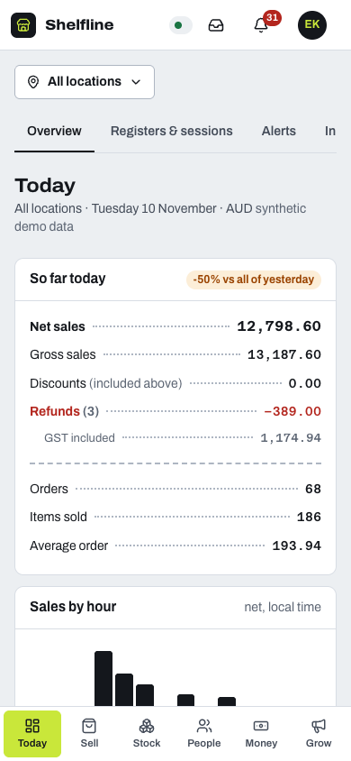 |

| Purchase orders | Bills and aging | Transfers |
|---|---|---|
| 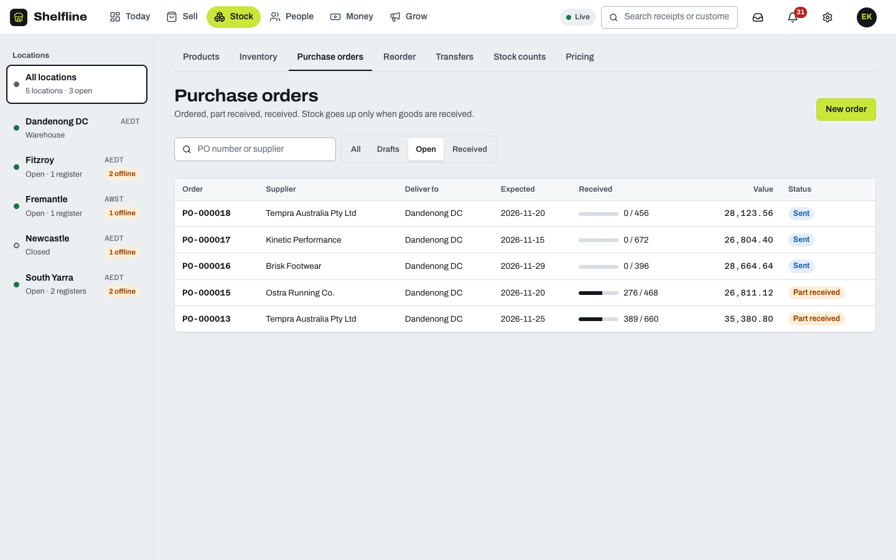 | 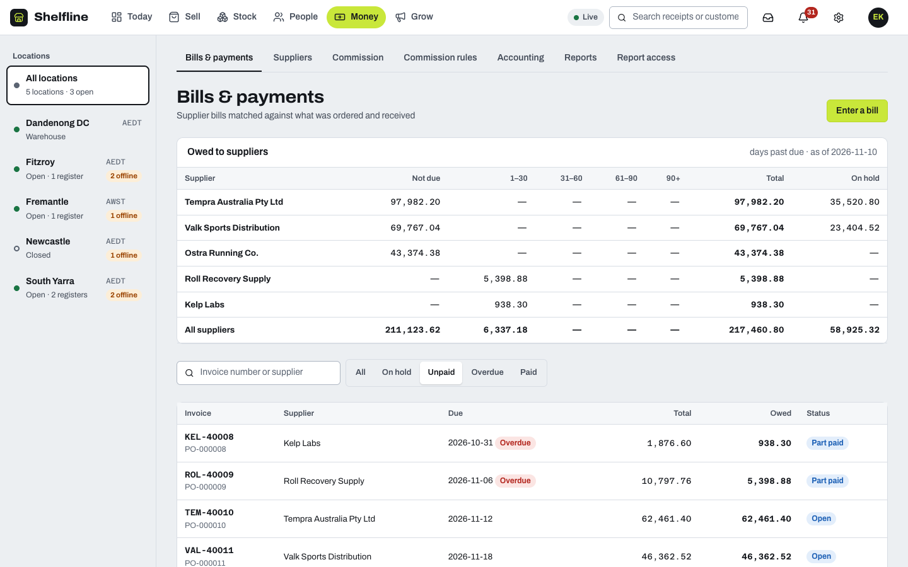 | 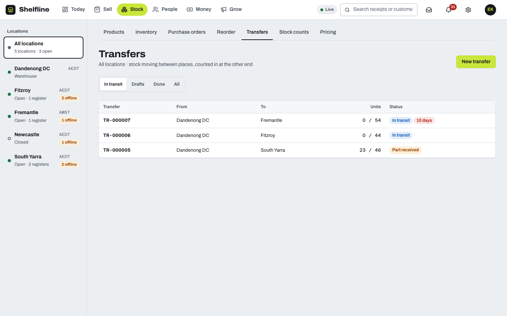 |

| Accounting (a closed day as a balanced journal) | Reorder (one draft order per supplier) |
|---|---|
| 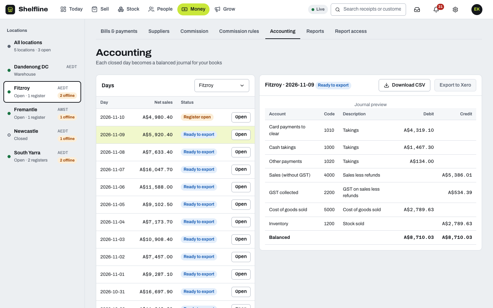 | 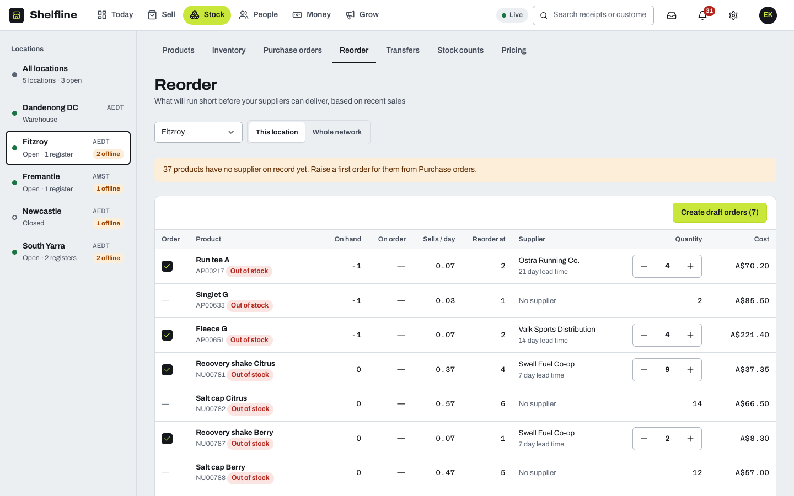 |

More in [docs/screenshots/](docs/screenshots/): suppliers, orders, products, inventory, reports, locations, inbox, notifications, end of day, devices, online orders, channels, campaigns, loyalty, single sign-on, the open-register screen.

## Run it

Needs Node 22+, pnpm 10 and Docker (for Postgres 17 on port 54340).

```
pnpm install
cp .env.example .env            # works as is for a local demo; change JWT_SECRET and ENCRYPTION_KEY (openssl rand -hex 32) for anything else
pnpm db:up                      # Postgres 17 on :54340
pnpm demo                       # migrates, then builds Kestrel Run Co. (about a minute); prints sign-ins
pnpm dev                        # API :8200, till :8210, admin :8220
```

- **Admin** (http://localhost:8220): `elena@kestrel.test` / `kestrel-demo-2026` (owner). `marcus@kestrel.test` (same password) is the Fitzroy manager and sees only his store.
- **Till** (http://localhost:8210): pair with a device key from `apps/api/.demo-devices.json` (written by the seed, shown once), server address `http://localhost:8200`, then sign in with an employee code from that file and PIN `4821`. The front desks can have today's register open when you run the seed during trading hours, so the side desks (FIT-2, SYA-2) are the easy way in.
- Start over: `pnpm demo:reset`. A shorter history: `DEMO_DAYS=14 pnpm demo:reset`.
- Purchasing: Stock → Purchase orders (new order, send, receive part of it with freight), Money → Bills & payments (the demo has one bill on hold for being over-billed and one for price). The Tempra bill releases itself when you receive the rest of its order.
- Attendance terminals: People → Terminals (register a terminal by serial, pair a bridge, records held for review). Build the bridge with `pnpm bridge:build` and try it with the simulator (see [apps/bridge/README.md](apps/bridge/README.md)).
- Roster and time: People → Schedule (week board per store; draft vs published; days below the staffing need) and People → Timesheets (hours, late, forgotten clock-outs, corrections, approval). On the till, Shift shows my published shifts. The seed has four weeks of history with a forgotten clock-out to find.
- Gift cards: Sell → Gift cards (issue a card: the code is shown once; top up; cancel) and a customer's store credit on their profile. On the till, pick Gift card or Store credit when paying. The seed prints three codes to try; Fremantle accepts gift cards offline up to A$25.
- Pricing: Stock → Pricing (price books and promotions; the seed's books and promotions start tomorrow). On the till, prices and promotions are computed offline from the last synced books; a sale priced from an older version is accepted and flagged with both versions.
- Transfers and counts: Stock → Transfers (send DC stock to a store, receive part and write off the missing unit) and Stock → Stock counts (blind count, review, commit). On the till, a manager's **Stock** screen receives transfers and counts by scanning (needs a connection).
- Accounting and reordering: Money → Accounting (account codes, a closed day as a balanced journal, download CSV or send to Xero as a draft; later changes go as adjustments only) and Stock → Reorder (what will run short before each supplier's own lead time, then one draft purchase order per supplier). Xero is tested against a stand-in only.
- Several organisations and single sign-on: see [docs/OPERATIONS.md](docs/OPERATIONS.md). Checks you can run: `pnpm backup:check` (restore a dump into a fresh database and compare every row), `pnpm perf` (p95 budgets on thousands of sales), `pnpm audit:supply` (vulnerabilities, licences, specifiers).
- Offline: in Chrome DevTools set the till to Offline and keep selling; reconnect and the queue drains (Sync screen). Install it as an app from the browser menu for the full PWA behaviour.
- A queue exported from a till ("Export unsent" on the Sync screen) can be loaded into the server with `node tools/import-queue.mjs file.json --api http://localhost:8200 --device-key … --employee … --pin …`.

## How it fits together

```
 iPad till (PWA)                       admin (browser)
 React + IndexedDB (Dexie)             React + TanStack Query
 prices, taxes, stock locally          live over SSE
        │  push commands (idempotent, gapless seq per device)   │  REST
        │  pull changes (cursor = txid + seq)                    │
        └───────────────► NestJS modular monolith ◄──────────────┘
                          Drizzle · PostgreSQL 17 (the only moving part)
                          ledgers append-only by trigger · change_log by trigger
                          LISTEN/NOTIFY → SSE · outbox for background work
```

- **One ledger per concern.** `stock_movement` is append-only (a trigger refuses UPDATE/DELETE); `stock_balance` is a projection that a check endpoint proves equals the sum of movements. Cash drawer expectations come from one `zReport` function used by the till (provisional) and the server (final).
- **The till is a replica, not a screen.** It sells from local data and queues commands. The server never rejects a physical fact (a sale that happened): it accepts and *flags* (negative stock, price mismatch, late sale, unapproved discount, skewed clock) and raises an exception for a person. Only genuinely invalid input is rejected.
- **Sync correctness.** Per-device sequence numbers must be gapless; a repeated command returns its original outcome; the pull cursor is bounded by `pg_snapshot_xmin`, because a plain sequence cursor can skip rows committed out of order. See [docs/TECH-SPEC.md](docs/TECH-SPEC.md) §5–6.
- **Landed cost.** Freight and other costs on a delivery are spread over its lines by value (largest remainder, so shares add up exactly) and enter the stock ledger as part of each unit's cost, so the moving average and the cost of the next sale include them.
- **Attendance terminals.** Terminals push to a small Go bridge on the store network, which stores each record on disk before answering and forwards in HMAC-signed batches (key derived on the server, nothing secret in the database). A record becomes one punch however often it is sent; one nobody can match is held for review.
- **Time.** A shift is stored as instants computed from the local date and wall-clock times in the store's zone, so a night across a daylight-saving change has its real length. A timesheet entry pairs an in punch with its out; a manager's correction is a new punch that supersedes the wrong one, never an edit, and approved days are frozen.
- **Gift cards and store credit.** An account's balance is the sum of its append-only entries (never stored). Spending locks the account, so two tills using one card are strictly ordered; a sale that overspends is accepted (the goods left), the balance goes negative and an overdraft is flagged. Offline use is off by default, per location, capped, and once per card per iPad.
- **Prices.** A variant sells at the highest-priority price book in force on the sale's business date at that location, else its catalogue price; promotions then take a percentage or an amount off a line (the best single promotion plus any stackable ones). Both are pure functions in `packages/pricing`, checked against 440 golden vectors from an independent Python reference, run by the till offline and by the server to verify every sale.
- **Transfers and counts.** Stock in transit sits in a transit place owned by the transfer, so totals never drift while goods travel; only a recorded shortage lowers the total. A count adjusts by (counted − expected at the snapshot), added to the balance at commit time, so sales made while counting are never overwritten.
- **Three-way match.** A supplier bill is checked line by line against what was ordered and what has been received (across all live bills for that order line). More billed than received, or a price different from the order, puts the bill on hold: it cannot be paid until the goods arrive (it then releases itself) or finance approves it with a reason that is kept in the audit log.
- **Money** is integer minor units everywhere; tax is computed per group with largest-remainder allocation; cash rounding (5c) is a separate step. `packages/pricing` is shared by the till and the server and is checked against 200 golden vectors from an independent Python implementation.
- **Tenancy.** Every organisation-owned table has row-level security: the app connects as a role that cannot bypass it, and each connection is stamped with the caller's organisation, so a missing filter in a signed-in request returns nothing instead of another organisation's data. An isolation test walks every table in both directions.
- **Postgres-only.** No Redis or queue server: background work uses an outbox table.

```
apps/api       NestJS 12 API, migrations (drizzle/), demo seed
apps/pos       iPad point of sale (Vite + React PWA, Workbox, Dexie)
apps/bridge    Go program for the store network: terminal push → durable queue → signed batches
apps/admin     back office (Vite + React)
packages/      money · pricing · contracts (zod command schemas) · sync-client · ui (components + CSS)
docs/ mockups/ planning, design, screenshots
tools/         screenshots, queue import, mockup build
```

## Tests

`pnpm test` runs about 1,000 tests (plus 20 Go tests: `pnpm test:bridge`) across the workspace: money (property tests), pricing (207, including the golden vectors), sync client (store contract for both adapters, engine), UI components, admin and POS logic, and the API against a real Postgres (`shelfline_test`).

- **Soak** (`apps/api/test/soak.test.ts`): 10 tills, 5,030 commands (4,382 sales, 309 refunds, 259 cash entries) through a network that loses requests, loses answers and duplicates calls. Every command lands exactly once, stock and cash equal an independent model, then the transactional tables are wiped and the same commands are replayed in a different interleaving: the ledger and cash checksums are identical. About 13 s of sync, about a minute in all. `SOAK_CLIENTS` and `SOAK_SALES` shrink it.
- **Model test**: 200 random scenarios with 10 clients, a flaky network and skewed clocks.
- **Browser end-to-end** (Playwright, Chrome): `pnpm --filter @shelfline/pos e2e` (24 tests, including a fully offline sale with reload and an "update required" server) and `pnpm --filter @shelfline/admin e2e` (30 tests, desktop and phone, including a purchase order received in two parts and a held bill that releases itself). They build the apps, start the API on a throw-away database `shelfline_e2e`, and drive Chrome.
- Property and mutation checks found real bugs along the way (they are listed in [docs/MILESTONES.md](docs/MILESTONES.md) under each milestone).

## Honest limits

- Not run on a real iPad or Safari. Service-worker, IndexedDB eviction and keyboard behaviour on iOS are assumptions (V01, V02 in [TECH-SPEC §10](docs/TECH-SPEC.md)).
- No payment terminal, receipt printer, cash-drawer or fingerprint hardware: the fingerprint path is built and tested against a simulator of the ZKTeco-style push dialect, which is from third-party sources and unverified on a real terminal (V09); the others are planned behind simulators; every hardware and third-party claim is listed as unverified in TECH-SPEC §10.
- System roles are written when an organisation is seeded; an existing organisation does not receive the new purchasing permissions until it is re-seeded or a custom-role editor exists (P2 later).
- Receiving a transfer and counting on the till need a connection (they act on the server's ledger directly); queueing them offline is an open decision.
- Gift cards are issued from the back office only (not sold as a till product yet); the till never holds card balances, so offline use cannot check them.
- Promotions are percent or amount off per line; buy-X-get-Y, coupon codes and cart-level promotions are not built.
- Purchase orders are not emailed (the "sent" status is a marker), and there are no supplier credit notes or foreign currency. The Xero export has never touched a real Xero organisation.
- Row-level security stops a bug in a signed-in request, not in the few unauthenticated entry points (which filter explicitly and are tested); single sign-on is OpenID Connect only and untried against a real provider; backups are proven restorable but not scheduled. Details in [docs/OPERATIONS.md](docs/OPERATIONS.md).
- Cashier switching needs the network (the PIN is checked on the server); an offline switch is an open decision.
- The customer list is replicated to the till for lookup; the privacy trade-off is recorded as an open decision.
- Demo credentials and the all-zero encryption key are for local use only.

All data, names and numbers are synthetic. Shelfline is standalone: written from scratch, with no code shared with any other project.
